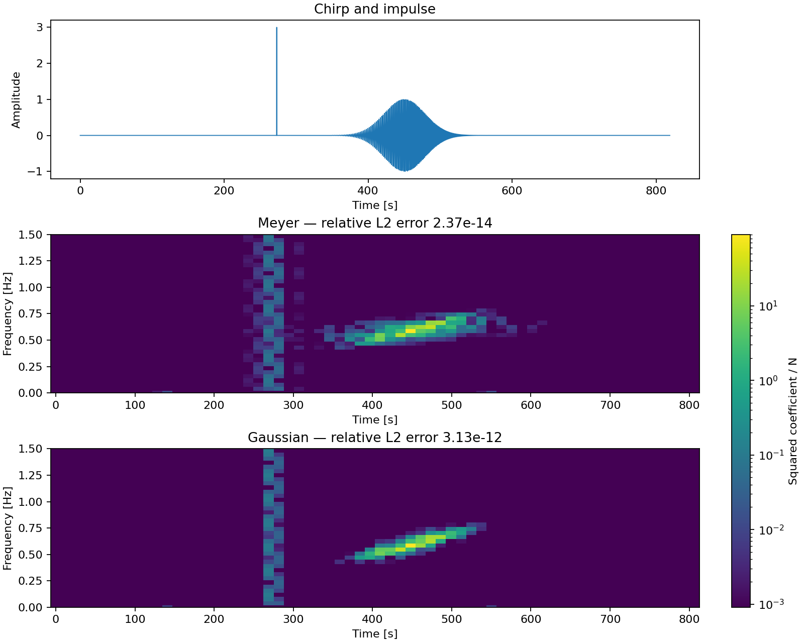

# Choosing Meyer Or Gaussian

Start with **Meyer** for a fast transform with compact frequency support,
particularly when separating narrow frequency features matters. Choose
**Gaussian** when keeping a transient or the influence of a data gap localized
in time matters more. Gaussian gains time localization by spreading each atom
over a wider frequency range, so the choice depends on your signal and noise.

Both families use the same `WDM` object and coefficient grid. The Gaussian option
implements the orthogonalized modified-Gaussian Wilson window (WDG) from
[Noah Pearson et al. (2026)](https://arxiv.org/abs/2609.05601).
It is an orthogonalized window rather than a Gaussian taper applied to the data.

| Your priority | Starting choice | Why |
|---|---|---|
| Narrow frequency features and small subbands | Meyer | Compact frequency support limits frequency mixing and keeps the required frequency margin small. |
| Short transients or local effects of gaps | Gaussian | Tighter time localization reduces their spread across nearby time bins. |
| Lowest transform cost or an existing analysis | Meyer | It is the established default and uses the existing compact kernels. |

## Compare The Same Signal



The top panel contains a chirp and an impulse at about 273 seconds. The two maps
use the package defaults on the same grid (`nt=64`, `nf=128`, `dt=0.1 s`).
They share one logarithmic color scale for squared coefficients divided by N;
values below `1e-5` of the shared maximum use the display floor. Compare the
impulse's horizontal spread and the chirp's frequency spread to see the tradeoff.
Only frequencies from 0 to 1.5 Hz are shown. The
[runnable example](../examples/gaussian_comparison.py) generates the plot and
reports relative reconstruction errors of about `2.4e-14` for Meyer and
`3.1e-12` for Gaussian.

This compares our default Meyer window (`a=1/3, d=1`) with default Gaussian
(`nu=0.5, support=16`). The paper's main comparison uses a higher-order Meyer
window (`d=6`), so its reported improvement should not be read as a measured
improvement over this package's default.

## Switch And Reconstruct

```python
import numpy as np
from wdm_transform import TimeSeries

ts = TimeSeries(np.random.default_rng(42).normal(size=8192), dt=0.1)
meyer = ts.to_wdm(nt=64)  # Meyer remains the default.
gaussian = ts.to_wdm(nt=64, window="gaussian")
recovered = gaussian.to_time_series()

assert (gaussian.window, gaussian.nu, gaussian.support) == ("gaussian", 0.5, 16)
np.testing.assert_allclose(recovered.data, ts.data, atol=1e-10, rtol=1e-10)
```

The same options work with `FrequencySeries.to_wdm`, the `WDM` factories and
the [four full transform functions](../reference/api.md). `WDM` stores the
effective window settings and reuses them for both time and frequency inverses.
If constructing it from existing coefficients, pass their originating settings.
To change family, transform the original series again: changing metadata alone
does not convert coefficients to another basis.

| Setting | Meyer | Gaussian |
|---|---|---|
| Selector | `window="meyer"` (default) | `window="gaussian"` |
| Shape defaults | `a=1/3, d=1` | `nu=0.5` |
| Frequency support | Existing compact window | `support=min(16, nf)` |

Gaussian accepts `0.3 <= nu <= 0.8` and integer `1 <= support <= nf`.
It rejects nondefault Meyer controls `a`/`d`; Meyer rejects Gaussian controls
`nu`/`support`. Existing calls without a selector keep their previous behavior.

## Use Compact Subbands

The compact Fourier-to-WDM, requested-band and inverse APIs support both
families with the same `window`, `nu` and `support` options. They take a crop
of the **one-sided** Fourier grid, including DC and Nyquist when those bins
are in the crop. Fourier bins outside that crop are treated as zero.

Reuse the same settings for analysis and synthesis. Changing the `window`
variable below switches the whole calculation:

```python
import numpy as np
from wdm_transform.transforms import (
    from_freq_to_wdm_subband,
    from_wdm_to_freq_subband,
)

nt, nf, dt = 64, 128, 0.1
n = nt * nf
window = "gaussian"  # Change to "meyer" to use the original window.
settings = dict(
    df=1.0 / (n * dt),
    nfreqs_fourier=n // 2 + 1,
    nfreqs_wdm=nf,
    ntimes_wdm=nt,
    backend="numpy",  # "jax" uses the same interface.
    window=window,
)
one_sided = np.fft.rfft(np.random.default_rng(7).normal(size=n))
crop_start = 400
crop = one_sided[crop_start:464]
coefficients, first_channel = from_freq_to_wdm_subband(
    crop, kmin=crop_start, **settings
)
reconstructed, first_bin = from_wdm_to_freq_subband(
    coefficients, mmin=first_channel, **settings
)

expected = np.zeros(n // 2 + 1, dtype=complex)
expected[crop_start:464] = crop
np.testing.assert_allclose(
    reconstructed,
    expected[first_bin:first_bin + len(reconstructed)],
    atol=1e-8,
    rtol=1e-10,
)
```

Gaussian's wider frequency support returns a wider range of channels and
reconstructed Fourier bins. The span helpers also accept `window`, `nu` and
`support`; use the same settings when planning a crop. To compute only a
requested channel block, use `from_freq_to_wdm_band`.

Subbands return bare arrays and their starting indices, so retain the window
settings yourself. Inverse synthesis treats coefficient channels outside the
supplied block as zero. Truncating that block further changes the reconstruction.
DC/Nyquist reflection and repeated contributions are handled by the compact
kernels without allocating the full Fourier spectrum.

## Choose Support And Check Your Analysis

`support=q` retains q half-band spacings on each side of a Gaussian window's
frequency center. A spacing is `1/(2*nf*dt)`, or `nt/2` full-FFT bins;
the retained window has `q*nt` taps. More support captures smaller tails and
improves reconstruction, while increasing work. It does not change the time grid.

Default `nu=0.5, support=16` gave relative reconstruction errors near `3e-12`
on the tested float64 grids. In a seeded noise check, support 4/8/16 gave errors
near `1e-3`, `1e-6` and `3e-12`. At `nu=0.3`, support 16 gave about `7e-8`;
support 32 reduced that to about `2e-14`. Small `nf` caps the available support.
Check the reconstruction error for your chosen grid and parameters rather than
assuming the default meets every accuracy requirement.

Gaussian full transforms support NumPy and JAX; the shared CuPy implementation
requires validation on a GPU. JAX supports JIT and derivatives with respect to
input signals. Gaussian does more frequency gathering and scattering: local
warm JAX timings stayed within roughly 3x Meyer, while NumPy synthesis reached
about 4.1x. Use `wdm_transform_window_benchmark --help` to measure your hardware.

Also check your noise model:
Gaussian's wider frequency window mixes a wider range of PSD values. The existing
`wdm_noise_variance` channel-center approximation has not been calibrated as a
Gaussian colored-noise covariance model. Reconstruction accuracy alone does not
validate a diagonal likelihood or quantify the effect of gaps.

**Reference:** Noah Pearson, Mesut Çalışkan, Sophie Bini and Neil J. Cornish
(2026), [*A compact time-frequency representation for gravitational-wave data
analysis*](https://arxiv.org/abs/2609.05601), arXiv:2609.05601.
